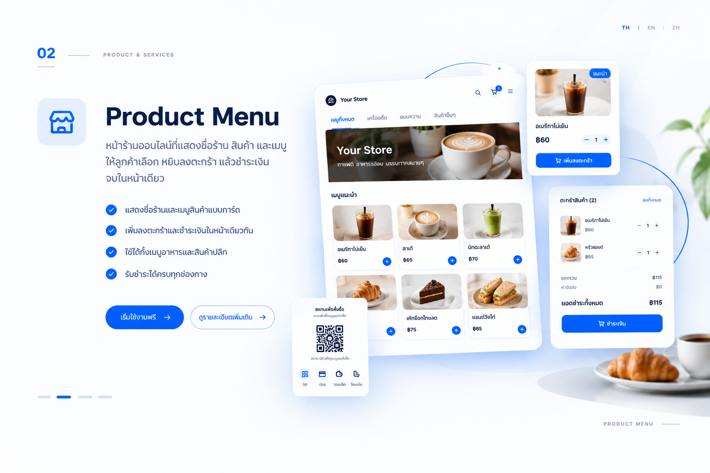
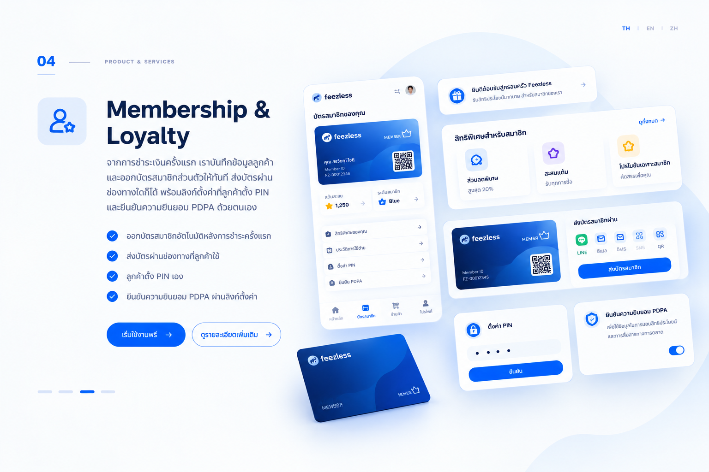
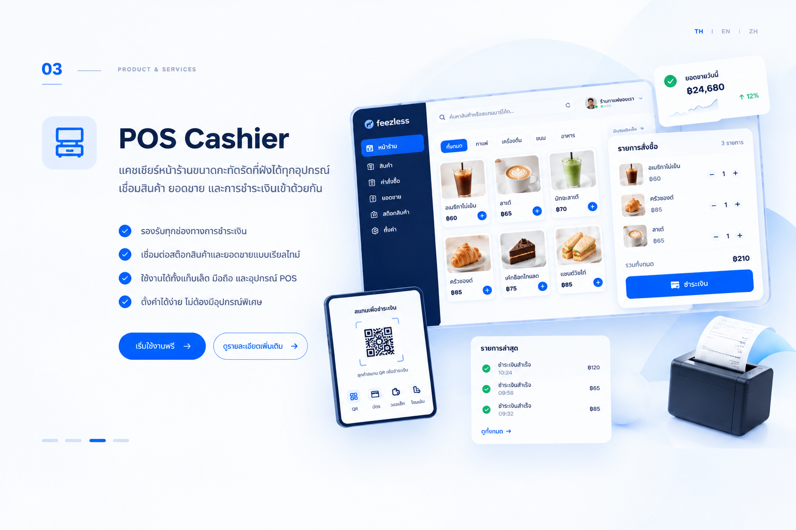

เปิดหน้าของแต่ละบริการเพื่อดูขั้นตอนการทำงาน สิ่งที่ต้องเตรียม และข้อมูลค่าบริการ [ติดต่อ Feezless เพื่อสอบถามข้อกำหนดการเปิดบัญชีและอัตราค่าบริการปัจจุบัน](https://zcal.co/i/gFYmG_pU) อัตราที่แสดงสำหรับระบบขายหน้าร้าน (POS) เป็นเพียงตัวอย่าง ไม่ใช่ราคาเสนอ

<Columns cols={2}>
  <Card title="เมนูสินค้า" icon="packages" href="/th/solutions/product-menu/index">
    

    ให้ลูกค้าเลือกดูสินค้า เพิ่มลงตะกร้า และชำระเงินได้ในหน้าเดียว

    **สิ่งที่ต้องเตรียม:** รายละเอียดสินค้า หรือรายการอาหารและเครื่องดื่ม พร้อมราคาสำหรับจัดทำแค็ตตาล็อก

    **ค่าบริการ:** ติดต่อ Feezless เพื่อสอบถามอัตราค่าธรรมเนียมธุรกรรมปัจจุบัน
  </Card>

  <Card title="ระบบขายหน้าร้าน (POS)" icon="cash-register" href="/th/solutions/pos/index">
    

    รับชำระเงินหน้าร้านผ่านโทรศัพท์หรือแท็บเล็ต และอัปเดตสต็อกสินค้าให้ตรงกับยอดขาย

    **สิ่งที่ต้องเตรียม:** โทรศัพท์หรือแท็บเล็ต พร้อมรายการสินค้าและราคาที่ต้องการขาย

    **ตัวอย่างค่าบริการ:** 0.8% ต่อธุรกรรม
  </Card>

  <Card title="ระบบสมาชิก" icon="user-star" href="/th/solutions/membership/index">
    

    เปลี่ยนการชำระเงินครั้งแรกของลูกค้าให้เป็นการสมัครสมาชิก พร้อมออกบัตรสมาชิกดิจิทัล

    **สิ่งที่ต้องเตรียม:** โปรแกรมสมาชิก รายละเอียดบัตรดิจิทัล และช่องทางส่งบัตรกับลิงก์ตั้งค่าให้ลูกค้า

    **ค่าบริการ:** ติดต่อ Feezless เพื่อสอบถามอัตราค่าธรรมเนียมธุรกรรมปัจจุบัน
  </Card>
</Columns>

## เมนูสินค้า

**เหมาะสำหรับ:** แค็ตตาล็อกสินค้า เมนูร้านอาหาร คาเฟ่ และร้านค้าปลีก

รวมสินค้าของคุณไว้ในร้านค้าออนไลน์หน้าเดียว ลูกค้าเลือกดูเมนู เพิ่มสินค้าลงตะกร้า และชำระเงินได้โดยไม่ต้องเปลี่ยนหน้า

- แสดงสินค้าในเมนูออนไลน์
- รวมการเลือกสินค้า ตะกร้า และการชำระเงินไว้ด้วยกัน
- ตัดสต็อกอัตโนมัติเมื่อการขายเสร็จสมบูรณ์

## ระบบขายหน้าร้าน (POS)

**เหมาะสำหรับ:** การขายหน้าร้านผ่านโทรศัพท์หรือแท็บเล็ต

ใช้อุปกรณ์มือถือเป็นหน้าจอแคชเชียร์โดยไม่ต้องซื้อเครื่องคิดเงินเฉพาะทาง บันทึกยอดขายและอัปเดตสต็อกสินค้าไปพร้อมกับการขาย

- รับคำสั่งซื้อและชำระเงินผ่านโทรศัพท์หรือแท็บเล็ต
- รองรับการเลือกวิธีชำระเงินของลูกค้าที่จุดขาย
- ตัดสต็อกอัตโนมัติเมื่อขายสินค้า

## ระบบสมาชิกและสิทธิประโยชน์

**เหมาะสำหรับ:** การสมัครสมาชิกให้ลูกค้าเมื่อชำระเงิน

ออกบัตรสมาชิกจากการชำระเงินครั้งแรกของลูกค้า และส่งบัตรผ่านช่องทางที่ลูกค้าเลือก ลูกค้าตั้งรหัส PIN และให้ความยินยอมตาม PDPA ด้วยตนเองผ่านลิงก์

- สร้างบัตรสมาชิกเป็นส่วนหนึ่งของขั้นตอนการชำระเงิน
- ส่งบัตรดิจิทัลให้ลูกค้า
- ให้ลูกค้าตั้งรหัส PIN และให้ความยินยอมด้วยตนเอง

## ขั้นตอนถัดไป

เลือกบริการที่ตรงกับรูปแบบการขายของคุณ หากมีคำถามเรื่องการตั้งค่าหรือการเชื่อมต่อระบบ ติดต่อ [Feezless](https://zcal.co/i/gFYmG_pU) พร้อมระบุชื่อบริการและลักษณะการใช้งาน

## Trust

<Columns cols={2}>
  <Card title="พันธมิตรด้านการชำระเงิน" icon="credit-card">
    **Visa**

    Feezless เป็นพันธมิตรโดยตรงกับ Visa
  </Card>

  <Card title="ความปลอดภัยและความน่าเชื่อถือ" icon="shield-lock" href="/th/legal/compliance-and-trust" cta="ดูรายละเอียด">
    อ่านข้อมูลการจดทะเบียนนิติบุคคล แนวทางคุ้มครองข้อมูลส่วนบุคคลตาม PDPA และการแยกสิทธิ์เข้าถึงระบบของ Feezless
  </Card>
</Columns>
