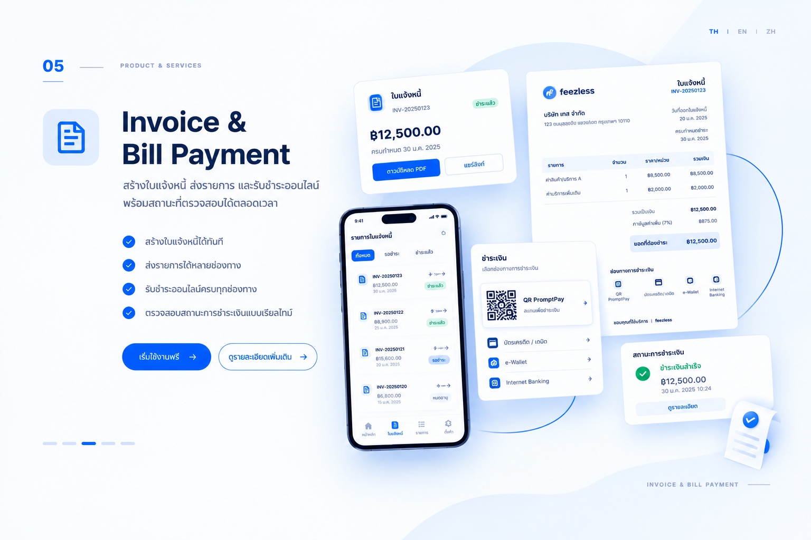

สร้างใบแจ้งหนี้และส่งลิงก์ให้ลูกค้าชำระเงินออนไลน์ผ่าน Feezless จากนั้นติดตามสถานะชำระแล้วหรือค้างชำระได้แบบเรียลไทม์ โดยไม่ต้องจัดทำเอกสารเรียกเก็บเงินแยกด้วยตนเอง

<Frame caption="ภาพประกอบบริการใบแจ้งหนี้และการชำระบิล">
  
</Frame>

## เหมาะสำหรับ

ใช้บริการนี้เมื่อคุณต้องการ:

- เรียกเก็บเงินจากลูกค้าสำหรับบริการหรือคำสั่งซื้อ
- ส่งลิงก์ให้ลูกค้าชำระเงินออนไลน์
- ติดตามบิลที่ชำระแล้วและบิลที่ต้องทวงถาม

## สิ่งที่ต้องเตรียม

ก่อนสร้างใบแจ้งหนี้ ให้เตรียมข้อมูลต่อไปนี้:

- **รายละเอียดการเรียกเก็บเงิน:** รายการสินค้าหรือบริการที่เรียกเก็บจากลูกค้า
- **จำนวนเงินที่ต้องการเรียกเก็บ:** ยอดที่ลูกค้าต้องชำระ
- **ช่องทางการติดต่อ:** วิธีส่งลิงก์ชำระเงินให้ลูกค้า

ติดต่อ [Feezless](https://zcal.co/i/gFYmG_pU) เพื่อสอบถามข้อกำหนดการเปิดบัญชีและการตั้งค่า

  

## วิธีการทำงาน

1. สร้างใบแจ้งหนี้พร้อมรายละเอียดการเรียกเก็บเงินและจำนวนเงิน
2. Feezless สร้างลิงก์ชำระเงินออนไลน์สำหรับใบแจ้งหนี้นั้น
3. ส่งลิงก์ให้ลูกค้าผ่านช่องทางการติดต่อที่ต้องการ
4. ลูกค้าเปิดลิงก์และชำระเงินออนไลน์
5. ติดตามสถานะใบแจ้งหนี้แบบเรียลไทม์เพื่อดูว่าชำระแล้วหรือยังค้างชำระ

ตัวอย่างสมมติ: ร้านค้าออกใบแจ้งหนี้ค่าบริการและส่งลิงก์ให้ลูกค้าชำระเงิน จากนั้นตรวจสอบสถานะบิลก่อนส่งมอบบริการ

ไอคอนคนแทนลูกค้า ไอคอนร้านแทนร้านค้า และไอคอน Feezless แทนระบบ เลือกขั้นตอนเพื่อดูมุมมองของแต่ละฝ่าย ภาพนี้เป็นภาพประกอบ ไม่ใช่หน้าจอหรือสถานะธุรกรรมจริง

<InvoiceFlowVisual />

> **หมายเหตุ:** การส่งลิงก์ชำระเงินเพียงอย่างเดียวไม่ใช่การยืนยันว่าชำระเงินแล้ว ตรวจสอบสถานะการชำระเงินที่ยืนยันแล้วก่อนส่งมอบสินค้าหรือบริการ

## ค่าบริการ

ติดต่อ [Feezless](https://zcal.co/i/gFYmG_pU) เพื่อสอบถามอัตราค่าธรรมเนียมธุรกรรมและค่าใช้จ่ายที่เกี่ยวข้องในปัจจุบันก่อนส่งใบแจ้งหนี้ หากมีคำถามเรื่องการตั้งค่าหรือการเชื่อมต่อระบบ ติดต่อ [Feezless](https://zcal.co/i/gFYmG_pU)

### ตัวอย่างการคำนวณค่าบริการ

สมมติว่าลูกค้าชำระใบแจ้งหนี้หนึ่งใบเป็นจำนวน 1,000 หน่วยเงิน ยอดนี้ใช้แสดงวิธีคำนวณเท่านั้น ไม่ใช่ค่าบริการออกใบแจ้งหนี้ที่ Feezless กำหนด

เอกสารยังไม่ได้ระบุอัตราค่าธรรมเนียมเป็นตัวเลขสำหรับบริการนี้ **หาก Feezless ยืนยันว่าคิดค่าธรรมเนียมแบบเปอร์เซ็นต์ที่อัตรา r%** จึงใช้สูตรต่อไปนี้ได้ โดย r แทนอัตราที่ได้รับการยืนยัน ไม่ใช่อัตราที่สมมติขึ้น

| รายการ | วิธีคำนวณ | จำนวนหน่วยเงิน |
| --- | --- | --- |
| ยอดชำระตัวอย่าง | 1 รายการ | 1,000 |
| ค่าธรรมเนียมแบบเปอร์เซ็นต์ หากใช้กับบัญชีของคุณ | 1,000 × r ÷ 100 | 10r |
| ยอดคงเหลือหลังหักเฉพาะค่าธรรมเนียมนี้ | 1,000 − 10r | ต้องทราบ r ก่อน |

กรอกอัตราที่ Feezless ยืนยันในเครื่องคำนวณเฉพาะเมื่อใช้การคิดค่าธรรมเนียมแบบเปอร์เซ็นต์ ตารางและเครื่องคำนวณไม่รวมภาษีหรือค่าใช้จ่ายอื่นที่อาจมี และไม่ใช่การยืนยันยอดที่จะได้รับจริง การแสดงทศนิยมสองตำแหน่งมีไว้ประกอบตัวอย่าง ไม่ใช่นโยบายการปัดเศษของ Feezless

<PricingCalculator />

<iframe src="https://zcal.co/i/gFYmG_pU?embed=1&embedType=iframe" title="Book a meeting with Feezless" loading="lazy" style={{ border: "none", width: "100%", maxWidth: "1096px", minWidth: "min(320px, 100%)", height: "723px", minHeight: "544px" }} id="zcal-invite" scrolling="no" />

## ขั้นตอนถัดไป

- กลับไปยัง [ภาพรวมบริการชำระเงิน](/th/index) เพื่อเปรียบเทียบบริการของ Feezless ทั้งหมด
- ดูบริการ [ลิงก์ชำระเงิน](/th/solutions/checkout/index) หากต้องการรับชำระเงินทันทีโดยไม่ต้องออกใบแจ้งหนี้

export const InvoiceFlowVisual = () => {
  const povLabels = { customer: "ลูกค้า", merchant: "ร้านค้า", system: "ระบบ Feezless" };
  const steps = [
    { label: "เตรียมบิล", title: "ร้านค้าเตรียมรายละเอียดบิล", pov: "merchant", story: "ร้านค้าจัดทำใบแจ้งหนี้สำหรับค่าบริการก่อนส่งให้ลูกค้า", customer: "รอรับลิงก์ชำระเงินสำหรับใบแจ้งหนี้", merchant: "สร้างใบแจ้งหนี้พร้อมรายละเอียดการเรียกเก็บเงินและจำนวนเงิน", system: "รอรับข้อมูลใบแจ้งหนี้จากร้านค้าเพื่อสร้างลิงก์ชำระเงิน", note: "การสร้างใบแจ้งหนี้ยังไม่ใช่การยืนยันว่าลูกค้าจะชำระเงิน" },
    { label: "สร้างลิงก์", title: "สร้างลิงก์ชำระเงิน", pov: "system", story: "Feezless สร้างลิงก์ชำระเงินออนไลน์สำหรับใบแจ้งหนี้ที่ร้านค้าส่งต่อให้ลูกค้า", customer: "รับลิงก์จากร้านค้าผ่านช่องทางการติดต่อ", merchant: "ได้รับลิงก์จาก Feezless เพื่อส่งให้ลูกค้า", system: "สร้างลิงก์ชำระเงินออนไลน์สำหรับใบแจ้งหนี้ตามข้อมูลที่ร้านค้ากรอก" },
    { label: "เปิดลิงก์", title: "ลูกค้าเปิดลิงก์ชำระเงิน", pov: "customer", story: "ลูกค้าเปิดลิงก์ใบแจ้งหนี้บนโทรศัพท์เพื่อเข้าสู่หน้าชำระเงิน", customer: "เปิดลิงก์ที่ได้รับเพื่อเข้าสู่หน้าชำระเงิน", merchant: "ใช้ลิงก์ชำระเงินออนไลน์สำหรับใบแจ้งหนี้นั้น", system: "แสดงหน้าชำระเงินตามลิงก์ที่สร้างไว้", note: "การเปิดหน้าชำระเงินไม่ใช่การยืนยันว่าชำระเงินแล้ว" },
    { label: "ชำระเงิน", title: "ลูกค้าชำระบิลออนไลน์", pov: "customer", story: "ลูกค้าดำเนินการชำระเงินตามขั้นตอนบนหน้าชำระเงิน", customer: "ดำเนินการชำระเงินตามขั้นตอนบนหน้าชำระเงิน", merchant: "ตรวจสอบสถานะการชำระเงินที่ยืนยันแล้วก่อนส่งมอบ", system: "บันทึกผลการชำระเงินและอัปเดตสถานะใบแจ้งหนี้", note: "การส่งลิงก์หรือเปิดหน้าชำระเงินไม่ใช่การยืนยันว่าชำระเงินแล้ว" },
    { label: "ยืนยันผล", title: "ระบบแสดงสถานะใบแจ้งหนี้", pov: "system", story: "Feezless แสดงสถานะใบแจ้งหนี้ให้ร้านค้าติดตามได้แบบเรียลไทม์", customer: "รับสินค้าหรือบริการเมื่อร้านค้ายืนยันการชำระเงินแล้ว", merchant: "ติดตามสถานะใบแจ้งหนี้แบบเรียลไทม์ว่าชำระแล้วหรือยังค้างชำระ", system: "แสดงสถานะใบแจ้งหนี้แบบเรียลไทม์ให้ร้านค้าทราบ", note: "ส่งมอบสินค้าหรือบริการเมื่อสถานะการชำระเงินได้รับการยืนยันแล้วเท่านั้น" },
  ];
  const [active, setActive] = useState(0);
  const uid = useId().replace(/:/g, "");
  const id = `invoice-story-${uid}`;
  const step = steps[active];
  const currentConnector = Math.max(0, active - 1);
  const panels = [
    { kind: "invoice", screen: "Invoice", actor: "ร้านค้า" },
    { kind: "link", screen: "Payment Link", actor: "ร้านค้าและลูกค้า" },
    { kind: "checkout", screen: "Checkout", actor: "ลูกค้า" },
    { kind: "payment", screen: "Payment", actor: "ลูกค้า" },
    { kind: "system", screen: "สถานะใบแจ้งหนี้", actor: "ร้านค้า" },
  ];
  const actorIcon = (pov, size = 24) => (
    
      {pov === "system" ?  : pov === "merchant" ? <Icon icon="building-store" size={size} /> : <Icon icon="user" size={size} />}
    
  );
  const btn = { display: "inline-flex", alignItems: "center", justifyContent: "center", width: 44, height: 44, padding: 0, borderRadius: 10, border: "1px solid rgba(127,127,127,.3)", background: "transparent", color: "inherit", font: "inherit", cursor: "pointer" };
  return (
    <section className="not-prose invoice-story" aria-label="เส้นทางลูกค้าใบแจ้งหนี้และการชำระบิล" style={{ width: "100%", minWidth: 0, border: "none", padding: 0, display: "grid", gap: 14, fontFamily: "inherit", background: "#ffffff", color: "#1e293b", colorScheme: "light", borderRadius: 16 }}>
      
      

        
        

          
          Feezless Platform
        

        <ol className="flow-diagram" aria-label="ภาพรวมลำดับขั้นตอน">
          {steps.map((item, i) => {
            const panel = panels[i];
            const selected = active === i;
            const reverse = Math.floor(i / 2) % 2 === 1;
            const downward = i % 2 === 1;
            const ink = selected ? "#1a73e8" : "#5f6368";
            return <li key={item.label} className="flow-stage" aria-current={selected ? "step" : undefined} style={{ gridColumn: reverse ? 2 - i % 2 : i % 2 + 1, gridRow: Math.floor(i / 2) + 1 }}>
              

                

                  {i + 1}
                  

                    {actorIcon(item.pov)}
                    

                      
{povLabels[item.pov]}

                      
{item.title}

                      
{item.story}

                    

                  

                

                <svg viewBox="0 0 240 150" aria-hidden="true" style={{ width: "100%", maxWidth: 280, height: "auto", display: "block", margin: "0 auto" }}>
                  {panel.kind === "system" ? <g>
                    {[0, 1, 2, 3].map((row) => <g key={row} transform={`translate(20 ${16 + row * 30})`}><rect width="200" height="28" fill="#e0e0e0" stroke="#bdbdbd" /><circle cx="14" cy="14" r="4" fill={ink} /><path d="M178 7V21M184 7V21M190 7V21" stroke="#b0b0b0" strokeWidth="2" /></g>)}
                    <rect x="55" y="57" width="130" height="37" fill="#e0e0e0" /><text x="120" y="80" textAnchor="middle" fontSize="14" fill="#3c4043" fontFamily="inherit">{panel.screen}</text>
                  </g> : <g>
                    <rect x="5" y="5" width="230" height="140" rx="4" fill="#fff" stroke="#bdc1c6" />
                    <path d="M6 23H234" stroke="#dadce0" /><rect x="6" y="6" width="228" height="16" rx="3" fill="#f1f3f4" />
                    <circle cx="14" cy="14" r="2.5" fill="#ea4335" /><circle cx="23" cy="14" r="2.5" fill="#fbbc04" /><circle cx="32" cy="14" r="2.5" fill="#34a853" />
                    <text x="18" y="42" fill="#3c4043" fontSize="12" fontFamily="inherit">{panel.screen}</text><path d="M6 50H234" stroke="#e8eaed" />
                    {panel.kind === "invoice" && <g>
                      {[0, 1, 2].map((row) => <g key={row} transform={`translate(18 ${59 + row * 22})`}><rect width="24" height="16" rx="2" fill="#e8eaed" /><rect x="34" y="2" width="120" height="4" rx="2" fill="#9aa0a6" /><rect x="34" y="10" width="80" height="3" rx="1" fill="#e0e0e0" /></g>)}
                      <path d="M18 132H222" stroke="#e8eaed" /><rect x="120" y="138" width="102" height="5" rx="2" fill="#9aa0a6" />
                    </g>}
                    {panel.kind === "link" && <g>
                      <path d="M24 62H216Q222 62 222 68V108Q222 114 216 114H50L36 124V114H24Q18 114 18 108V68Q18 62 24 62Z" fill="#f1f3f4" stroke="#dadce0" />
                      <g transform="translate(38 76)" fill="none" stroke="#5f6368" strokeWidth="2" strokeLinecap="round"><path d="M10 7L15 2A6 6 0 0 1 24 11L19 16M14 19L9 24A6 6 0 0 1 0 15L5 10M8 16L16 8" /></g>
                      <rect x="80" y="80" width="120" height="5" fill="#9aa0a6" /><rect x="80" y="94" width="90" height="4" fill="#dadce0" />
                    </g>}
                    {panel.kind === "checkout" && <g>
                      <rect x="20" y="60" width="124" height="72" rx="3" fill="#fff" stroke="#dadce0" />
                      <rect x="32" y="74" width="98" height="6" fill="#9aa0a6" /><rect x="32" y="89" width="82" height="4" fill="#e0e0e0" /><rect x="32" y="101" width="65" height="4" fill="#e0e0e0" /><rect x="32" y="116" width="98" height="5" fill="#dadce0" />
                      <path d="M164 109L208 65M181 65H208V92" fill="none" stroke="#1a73e8" strokeWidth="3" strokeLinecap="round" strokeLinejoin="round" />
                    </g>}
                    {panel.kind === "payment" && <g>
                      {[0, 1, 2].map((row) => <g key={row} transform={`translate(18 ${61 + row * 20})`}><rect width="14" height="10" rx="2" fill="#e8eaed" /><rect x="25" y="2" width={142 - row * 22} height="5" rx="2" fill="#dadce0" /><path d="M0 16H202" stroke="#f1f3f4" /></g>)}
                      <circle cx="33" cy="126" r="9" fill="none" stroke="#9aa0a6" strokeWidth="1.5" /><path d="M33 120V126L37 129" fill="none" stroke="#9aa0a6" strokeWidth="1.5" /><rect x="164" y="119" width="56" height="15" rx="2" fill="#1a73e8" />
                    </g>}
                  </g>}
                </svg>
              

              {i < steps.length - 1 && 

                <svg viewBox="0 0 64 64" style={{ width: "100%", height: "100%", display: "block" }}>
                  <g className="flow-connector" data-active={i === currentConnector ? "true" : "false"}>
                    <path d="M6 32H21M43 32H57" fill="none" stroke={i === currentConnector ? "#1a73e8" : "currentColor"} strokeWidth="1.8" strokeDasharray={i === currentConnector ? undefined : "1 5"} strokeLinecap="round" />
                    <path d="M50 26L57 32L50 38" fill="none" stroke={i === currentConnector ? "#1a73e8" : "currentColor"} strokeWidth="1.8" strokeLinecap="round" strokeLinejoin="round" />
                  </g>
                  <circle cx="32" cy="32" r="11" fill="#fff" stroke="#3c4043" strokeWidth="1.2" />
                  <g className="flow-arrow-number" style={{ transformOrigin: "32px 32px", transform: downward ? "rotate(-90deg)" : reverse ? "rotate(-180deg)" : "none" }}><text x="32" y="36.5" textAnchor="middle" fontFamily="inherit" fontSize="13" fill="#202124">{i + 2}</text></g>
                </svg>
              
}
            </li>;
          })}
        </ol>
        
ภาพลำดับขั้นตอน ไม่ใช่โครงสร้างระบบ หน้าจอ หรือสถานะธุรกรรมจริง

      

      

        {steps.slice(0, -1).map((_, i) => 
)}
        {steps.map((item, i) => <button key={item.label} className="flow-step-button" data-passed={i < active ? "true" : "false"} type="button" onClick={() => setActive(i)} aria-pressed={active === i} aria-controls={`${id}-detail`} aria-label={`ขั้นตอนที่ ${i + 1}: ${item.label}`} style={{ position: "relative", zIndex: 1, display: "flex", flexDirection: "column", alignItems: "center", gap: 8, width: "100%", minWidth: 0, minHeight: 70, padding: "0 4px 6px", border: "none", borderRadius: 8, background: "transparent", color: "inherit", font: "inherit", fontSize: 13, lineHeight: 1.5, cursor: "pointer" }}>
          {i + 1}
          {item.label}
        </button>)}
      

      

        

          {actorIcon(step.pov)}
          {step.title}
        

        

          

            

              {actorIcon("customer", 20)}
              ลูกค้า
            

            
{step.customer}

          

          

            

              {actorIcon("merchant", 20)}
              ร้านค้า
            

            
{step.merchant}

          

          

            

              {actorIcon("system", 20)}
              ระบบ Feezless
            

            
{step.system}

          

        

        {step.note && 
<strong>ก่อนส่งมอบ: </strong>{step.note}
}
      

      

        <button type="button" style={btn} disabled={active === 0} onClick={() => setActive((value) => Math.max(0, value - 1))} aria-label="ย้อนกลับ" title="ย้อนกลับ"><Icon icon="chevron-left" size={16} /></button>
        {active + 1} / {steps.length}
        <button type="button" style={btn} disabled={active === steps.length - 1} onClick={() => setActive((value) => Math.min(steps.length - 1, value + 1))} aria-label="ถัดไป" title="ถัดไป"><Icon icon="chevron-right" size={16} /></button>
      

    </section>
  );
};

export const PricingCalculator = () => {
  const [amount, setAmount] = useState("1000");
  const [rate, setRate] = useState("");
  const value = Number(amount);
  const percent = Number(rate);
  const fee = value * (percent / 100);
  const remainder = value - fee;
  const valid = amount.trim() !== "" && rate.trim() !== "" && Number.isFinite(value) && value >= 0 && Number.isFinite(percent) && percent >= 0 && Number.isFinite(fee) && Number.isFinite(remainder);
  const format = (number) => number.toLocaleString("th-TH", { minimumFractionDigits: 2, maximumFractionDigits: 2 });
  const inputStyle = { width: "100%", minWidth: 0, boxSizing: "border-box", border: "1px solid rgba(127,127,127,.35)", borderRadius: 8, padding: "8px 12px", background: "transparent", color: "inherit", font: "inherit" };
  return (
    

      <strong>คำนวณเมื่อทราบอัตราแบบเปอร์เซ็นต์แล้ว</strong>
      <label style={{ display: "grid", gap: 6 }}>
        ยอดชำระตัวอย่าง (หน่วยเงิน)
        <input type="number" min="0" step="any" value={amount} onChange={(event) => setAmount(event.target.value)} style={inputStyle} />
      </label>
      <label style={{ display: "grid", gap: 6 }}>
        อัตราแบบเปอร์เซ็นต์ที่ Feezless ยืนยัน (%)
        <input type="number" min="0" step="any" value={rate} onChange={(event) => setRate(event.target.value)} style={inputStyle} />
      </label>
      

        {valid ? <>
ค่าธรรมเนียม: <strong>{format(fee)} หน่วยเงิน</strong>

ยอดคงเหลือหลังหักเฉพาะค่าธรรมเนียมนี้: <strong>{format(remainder)} หน่วยเงิน</strong>
</> : 
กรอกยอดชำระและอัตราที่ Feezless ยืนยันเป็นตัวเลขที่ไม่ติดลบ เฉพาะเมื่อใช้การคิดค่าธรรมเนียมแบบเปอร์เซ็นต์ ช่องอัตราที่ว่างไม่ได้หมายถึงค่าธรรมเนียม 0%
}
      

      <small>ไม่รวมภาษีหรือค่าใช้จ่ายอื่นที่อาจมี ไม่ใช่ยอดรับเงินจริง แสดงทศนิยมสองตำแหน่งเพื่อประกอบตัวอย่างเท่านั้น</small>
    

  );
};
