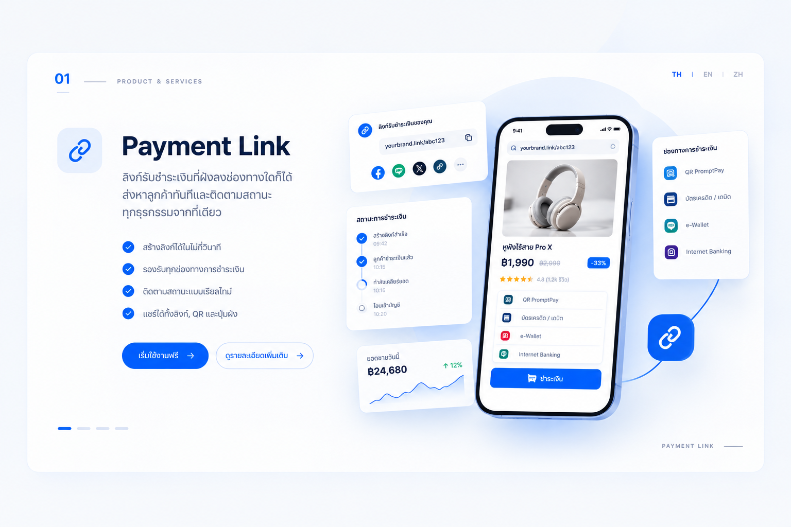

ลิงก์ชำระเงิน (Checkout Cart) ช่วยให้คุณรับชำระเงินด้วยการแชร์ลิงก์ผ่านช่องทางที่ลูกค้าใช้อยู่ โดยไม่ต้องสร้างแค็ตตาล็อกสินค้าหรือร้านค้าออนไลน์ ลูกค้าเปิดลิงก์เพื่อชำระเงิน ส่วนคุณติดตามยอดรับชำระและยอดค้างชำระได้แบบเรียลไทม์

<Frame caption="ภาพประกอบบริการลิงก์ชำระเงิน">
  
</Frame>

**เหมาะสำหรับ:** การรับชำระเงินจากการสนทนา โพสต์บนโซเชียลมีเดีย เว็บไซต์ และช่องทางที่การส่งลิงก์โดยตรงเป็นวิธีรับชำระเงินที่รวดเร็วที่สุด

## วิธีการทำงาน

1. สร้างลิงก์ชำระเงินตามจำนวนเงินที่ต้องการเรียกเก็บ
2. แชร์ลิงก์ผ่านแชต โพสต์บนโซเชียลมีเดีย หรือเว็บไซต์ของคุณ
3. ลูกค้าเปิดลิงก์และชำระเงิน
4. ติดตามยอดที่รับชำระแล้วและยอดค้างชำระแบบเรียลไทม์

ดูเส้นทางลูกค้าตั้งแต่รับลิงก์จนถึงยืนยันผล โดยเลือกจุดบนเส้นขั้นตอนด้านล่าง ภาพนี้เป็นภาพประกอบ ไม่ใช่หน้าจอหรือสถานะธุรกรรมจริง

<CheckoutFlowVisual />

## สิ่งที่ต้องเตรียม

ก่อนเริ่มรับชำระเงิน ให้เตรียมข้อมูลต่อไปนี้:

- จำนวนเงินและคำอธิบายรายการที่ต้องการเรียกเก็บ
- ช่องทางส่งลิงก์ให้ลูกค้า เช่น แชต โซเชียลมีเดีย หรือเว็บไซต์

ติดต่อ [Feezless](https://zcal.co/i/gFYmG_pU) เพื่อสอบถามข้อกำหนดการเปิดบัญชีและคุณสมบัติผู้สมัคร

## ค่าบริการ

ติดต่อ [Feezless](https://zcal.co/i/gFYmG_pU) เพื่อสอบถามอัตราค่าธรรมเนียมธุรกรรมและค่าใช้จ่ายที่เกี่ยวข้องในปัจจุบันก่อนเริ่มรับชำระเงิน

### ตัวอย่างการคำนวณค่าบริการ

ใช้ยอดชำระผ่านลิงก์ 1,000 หน่วยเงินและอัตราตัวอย่าง 2.0% ที่ระบุในเอกสารเพื่อแสดงวิธีคำนวณ อัตรานี้เป็นเพียงตัวอย่าง ไม่ใช่อัตราที่ได้รับการอนุมัติหรือราคาเสนอ

| รายการ | วิธีคำนวณ | จำนวนหน่วยเงิน |
| --- | --- | --- |
| ยอดชำระตัวอย่าง | 1 รายการ | 1,000 |
| ค่าธรรมเนียมตามอัตราตัวอย่าง | 1,000 × 2.0 ÷ 100 | 20 |
| ยอดคงเหลือหลังหักเฉพาะค่าธรรมเนียมนี้ | 1,000 − 20 | 980 |

ตารางและเครื่องคำนวณแสดงเฉพาะค่าธรรมเนียมแบบเปอร์เซ็นต์ ไม่รวมภาษีหรือค่าใช้จ่ายอื่นที่อาจมี และไม่ใช่การยืนยันยอดที่จะได้รับจริง การแสดงทศนิยมสองตำแหน่งมีไว้ประกอบตัวอย่าง ไม่ใช่นโยบายการปัดเศษของ Feezless

<PricingCalculator />

> **หมายเหตุ:** การสร้างลิงก์ชำระเงินหรือการได้รับหลักฐานการโอนเงินเพียงอย่างเดียวไม่ใช่การยืนยันว่าชำระเงินแล้ว ตรวจสอบสถานะการชำระเงินที่ยืนยันแล้วก่อนส่งมอบสินค้าหรือบริการ

## ต้องการให้ลูกค้าเลือกสินค้าและใส่ตะกร้าหรือไม่

หากต้องการให้ลูกค้าเลือกดูสินค้า เพิ่มลงตะกร้า และชำระเงินในหน้าเดียว ดูบริการ [เมนูสินค้า (Product Menu)](/th/solutions/product-menu/index)

<iframe src="https://zcal.co/i/gFYmG_pU?embed=1&embedType=iframe" title="Book a meeting with Feezless" loading="lazy" style={{ border: "none", width: "100%", maxWidth: "1096px", minWidth: "min(320px, 100%)", height: "723px", minHeight: "544px" }} id="zcal-invite" scrolling="no" />

## ขั้นตอนถัดไป

หากต้องการเริ่มใช้งานลิงก์ชำระเงิน ติดต่อ [Feezless](https://zcal.co/i/gFYmG_pU) พร้อมระบุปริมาณการขายที่คาดการณ์ไว้และช่องทางที่วางแผนจะแชร์ลิงก์ชำระเงิน

export const CheckoutFlowVisual = () => {
  const steps = [
    { label: "รับลิงก์", title: "ลูกค้ารับลิงก์ชำระเงินจากร้านค้า", customer: "รับลิงก์ชำระเงินผ่านแชต โซเชียลมีเดีย หรือเว็บไซต์ของร้านค้า", merchant: "สร้างลิงก์ตามจำนวนเงินที่ต้องการเรียกเก็บ แล้วแชร์ผ่านช่องทางที่ลูกค้าใช้", scene: "ลูกค้ารับลิงก์ชำระเงินจากร้านค้าทางแชต" },
    { label: "เปิดลิงก์", title: "เปิดลิงก์เพื่อเข้าสู่หน้าชำระเงิน", customer: "เปิดลิงก์ที่ได้รับเพื่อชำระเงินออนไลน์", merchant: "ใช้ลิงก์ที่สร้างตามจำนวนเงินที่ต้องการเรียกเก็บ", scene: "ลูกค้าเปิดลิงก์บนโทรศัพท์เพื่อเข้าหน้าชำระเงิน" },
    { label: "ชำระเงิน", title: "ชำระเงินผ่านลิงก์", customer: "ดำเนินการตามขั้นตอนบนหน้าชำระเงิน", merchant: "ตรวจสอบสถานะการชำระเงินก่อนส่งมอบสินค้าหรือบริการ", scene: "ลูกค้าชำระเงินผ่านลิงก์ ร้านค้ารอตรวจสอบผล", note: "การสร้างลิงก์หรือได้รับหลักฐานการโอนเพียงอย่างเดียวไม่ใช่การยืนยันว่าชำระเงินแล้ว" },
    { label: "ยืนยันผล", title: "ตรวจสอบยอดรับชำระก่อนส่งมอบ", customer: "รับสินค้าหรือบริการเมื่อร้านค้ายืนยันการชำระเงินแล้ว", merchant: "ติดตามยอดรับชำระและยอดค้างชำระแบบเรียลไทม์ ส่งมอบเมื่อยืนยันแล้ว", scene: "ภาพจำลองการตรวจสอบสถานะหลังยืนยันการชำระเงิน", note: "ส่งมอบสินค้าหรือบริการเมื่อสถานะการชำระเงินได้รับการยืนยันแล้วเท่านั้น" },
  ];
  const [active, setActive] = useState(0);
  const uid = useId().replace(/:/g, "");
  const id = `checkout-story-${uid}`;
  const paint = (name) => `url(#${id}-${name})`;
  const step = steps[active];
  const btn = { display: "inline-flex", alignItems: "center", justifyContent: "center", width: 44, height: 44, padding: 0, borderRadius: 10, border: "1px solid rgba(127,127,127,.3)", background: "transparent", color: "inherit", font: "inherit", cursor: "pointer" };
  return (
    <section className="not-prose checkout-story" aria-label="เส้นทางลูกค้าลิงก์ชำระเงิน" style={{ width: "100%", minWidth: 0, border: "none", padding: 0, display: "grid", gap: 14, fontFamily: "inherit", background: "#ffffff", color: "#1e293b", colorScheme: "light", borderRadius: 16 }}>
      
      

        <svg viewBox="0 0 640 240" role="img" aria-label={step.scene} style={{ width: "100%", height: "auto", display: "block" }}>
          <defs>
            <linearGradient id={`${id}-blue`} x1="0" y1="0" x2="1" y2="1"><stop offset="0" stopColor="#94b6ff" /><stop offset="1" stopColor="#2454d6" /></linearGradient>
            <linearGradient id={`${id}-white`} x1="0" y1="0" x2="1" y2="1"><stop offset="0" stopColor="#ffffff" /><stop offset="1" stopColor="#dce6fa" /></linearGradient>
            <linearGradient id={`${id}-dark`} x1="0" y1="0" x2="1" y2="1"><stop offset="0" stopColor="#525e78" /><stop offset="1" stopColor="#182139" /></linearGradient>
            <filter id={`${id}-shadow`} x="-50%" y="-100%" width="200%" height="300%"><feGaussianBlur stdDeviation="5" /></filter>
          </defs>
          <ellipse cx="320" cy="210" rx="238" ry="12" fill="#293957" opacity=".12" filter={paint("shadow")} />
          <g transform="translate(110 68)">
            <circle cx="0" cy="0" r="25" fill={paint("white")} />
            <path d="M-38 99V58C-38 20 38 20 38 58V99Z" fill={paint("blue")} />
            <path d="M-24 52Q0 65 24 52" fill="none" stroke="#fff" strokeOpacity=".45" strokeWidth="4" />
            <path d="M28 64L58 48" fill="none" stroke="#78a2fa" strokeWidth="14" strokeLinecap="round" />
          </g>
          <g transform="translate(530 118)">
            <title>Feezless Platform</title>
            <rect x="-56" y="-56" width="112" height="112" rx="26" fill={paint("white")} stroke="#c7d8f5" strokeWidth="1.5" style={{ filter: "drop-shadow(0 6px 8px rgba(47,107,255,.18))" }} />
            <image href="https://feezless-pull-storage.b-cdn.net/brand/favicon.png" x="-40" y="-40" width="80" height="80" preserveAspectRatio="xMidYMid meet" />
          </g>
          <g style={{ filter: "drop-shadow(0 0 3px rgba(71,119,223,.85)) drop-shadow(0 0 8px rgba(71,119,223,.45))" }}>
            <path d="M177 128H225M415 128H463" fill="none" stroke="#7296e4" strokeWidth="3" strokeDasharray="5 7" />
            <path d={active === 0 || active === 3 ? "M187 121L177 128L187 135M425 121L415 128L425 135" : "M215 121L225 128L215 135M453 121L463 128L453 135"} fill="none" stroke="#4777df" strokeWidth="3" strokeLinecap="round" strokeLinejoin="round" />
          </g>
          {active === 0 && <g transform="translate(320 118)">
            <rect x="-62" y="-59" width="124" height="112" rx="16" fill="#b9cff9" transform="rotate(-6)" />
            <path d="M-48-64H48Q64-64 64-48V32Q64 48 48 48H-20L-48 66V48Q-64 48-64 32V-48Q-64-64-48-64Z" fill={paint("white")} />
            <rect x="-43" y="-45" width="64" height="7" rx="3" fill="#b3c6e9" />
            <rect x="-43" y="-30" width="86" height="5" rx="2" fill="#c6d3e8" />
            <g transform="translate(0 8) rotate(-32)" fill="none" stroke="#4777df" strokeWidth="6"><rect x="-34" y="-11" width="42" height="22" rx="11" /><rect x="-8" y="-11" width="42" height="22" rx="11" /><path d="M-9 0H9" /></g>
          </g>}
          {active === 1 && <g transform="translate(320 118)">
            <rect x="-38" y="-70" width="76" height="142" rx="16" fill={paint("dark")} />
            <rect x="-32" y="-62" width="64" height="126" rx="11" fill={paint("white")} />
            <rect x="-22" y="-46" width="44" height="8" rx="4" fill="#c7d3f5" />
            <rect x="-22" y="-30" width="32" height="6" rx="3" fill="#a0b7de" />
            <g transform="translate(0 2) rotate(-32) scale(.65)" fill="none" stroke="#4777df" strokeWidth="6"><rect x="-34" y="-11" width="42" height="22" rx="11" /><rect x="-8" y="-11" width="42" height="22" rx="11" /><path d="M-9 0H9" /></g>
            <rect x="-22" y="33" width="44" height="14" rx="7" fill={paint("blue")} />
            <circle cx="40" cy="-52" r="20" fill={paint("blue")} />
            <path d="M33-45L47-59M35-59H47V-47" fill="none" stroke="#fff" strokeWidth="3" strokeLinecap="round" strokeLinejoin="round" />
          </g>}
          {active === 2 && <g transform="translate(320 118)">
            <rect x="-38" y="-70" width="76" height="136" rx="16" fill={paint("dark")} />
            <rect x="-32" y="-62" width="64" height="120" rx="11" fill={paint("white")} />
            <rect x="-22" y="-48" width="44" height="8" rx="4" fill="#c7d3f5" />
            <rect x="-22" y="-32" width="44" height="18" rx="6" fill="#dbe7ff" stroke="#4777df" strokeWidth="1.5" />
            <rect x="-16" y="-24" width="32" height="4" rx="2" fill="#4777df" />
            <rect x="-22" y="-6" width="44" height="18" rx="6" fill="#edf1f8" />
            <rect x="-16" y="2" width="20" height="4" rx="2" fill="#9dafcd" />
            <rect x="-22" y="20" width="44" height="18" rx="6" fill="#edf1f8" />
            <rect x="-16" y="28" width="20" height="4" rx="2" fill="#9dafcd" />
            <circle cx="40" cy="-48" r="20" fill={paint("blue")} />
            <path d="M40-60V-48L48-42" fill="none" stroke="#fff" strokeWidth="3" strokeLinecap="round" />
          </g>}
          {active === 3 && <g transform="translate(320 118)">
            <rect x="-54" y="-56" width="108" height="108" rx="12" fill={paint("white")} stroke="#c3d2ff" />
            <rect x="-44" y="-46" width="88" height="14" rx="7" fill="#c7d3f5" />
            <rect x="-44" y="-24" width="36" height="10" rx="5" fill={paint("blue")} />
            <rect x="-44" y="-6" width="88" height="8" rx="4" fill="#a0b7de" />
            <rect x="-44" y="10" width="60" height="8" rx="4" fill="#a0b7de" />
            <rect x="-44" y="26" width="88" height="8" rx="4" fill="#a0b7de" />
            <rect x="-44" y="42" width="48" height="8" rx="4" fill="#a0b7de" />
            <circle cx="50" cy="-48" r="20" fill={paint("blue")} />
            <path d="M38-48L47-39L63-57" fill="none" stroke="#fff" strokeWidth="4" strokeLinecap="round" strokeLinejoin="round" />
          </g>}
        </svg>
        
ลูกค้าFeezless Platform

      

      

        

        

        {steps.map((item, i) => <button key={item.label} type="button" onClick={() => setActive(i)} aria-pressed={active === i} aria-controls={`${id}-detail`} aria-label={`ขั้นตอนที่ ${i + 1}: ${item.label}`} style={{ position: "relative", zIndex: 1, display: "flex", flexDirection: "column", alignItems: "center", gap: 8, width: "100%", minWidth: 0, minHeight: 70, padding: "0 4px 6px", border: "none", borderRadius: 8, background: "transparent", color: "inherit", font: "inherit", fontSize: 13, lineHeight: 1.5, cursor: "pointer" }}>
          {i + 1}
          {item.label}
        </button>)}
      

      

        
{step.title}

        

          

มุมลูกค้า

{step.customer}

          

ร้านค้าและระบบ

{step.merchant}

        

        {step.note && 
<strong>ก่อนส่งมอบ: </strong>{step.note}
}
      

      

        <button type="button" style={btn} disabled={active === 0} onClick={() => setActive((value) => Math.max(0, value - 1))} aria-label="ย้อนกลับ" title="ย้อนกลับ"><Icon icon="chevron-left" size={16} /></button>
        {active + 1} / {steps.length}
        <button type="button" style={btn} disabled={active === steps.length - 1} onClick={() => setActive((value) => Math.min(steps.length - 1, value + 1))} aria-label="ถัดไป" title="ถัดไป"><Icon icon="chevron-right" size={16} /></button>
      

    </section>
  );
};

export const PricingCalculator = () => {
  const [amount, setAmount] = useState("1000");
  const rate = 2;
  const value = Number(amount);
  const fee = value * (rate / 100);
  const remainder = value - fee;
  const valid = amount.trim() !== "" && Number.isFinite(value) && value >= 0 && Number.isFinite(fee) && Number.isFinite(remainder);
  const format = (number) => number.toLocaleString("th-TH", { minimumFractionDigits: 2, maximumFractionDigits: 2 });
  const inputStyle = { width: "100%", minWidth: 0, boxSizing: "border-box", border: "1px solid rgba(127,127,127,.35)", borderRadius: 8, padding: "8px 12px", background: "transparent", color: "inherit", font: "inherit" };
  return (
    

      <strong>ทดลองคำนวณค่าธรรมเนียม</strong>
      <label style={{ display: "grid", gap: 6 }}>
        ยอดชำระตัวอย่าง (หน่วยเงิน)
        <input type="number" min="0" step="any" value={amount} onChange={(event) => setAmount(event.target.value)} style={inputStyle} />
      </label>
      
อัตราตัวอย่างคงที่: 2.0% (ไม่ใช่อัตราที่ได้รับการอนุมัติ)

      

        {valid ? <>
ค่าธรรมเนียม: <strong>{format(fee)} หน่วยเงิน</strong>

ยอดคงเหลือหลังหักเฉพาะค่าธรรมเนียมนี้: <strong>{format(remainder)} หน่วยเงิน</strong>
</> : 
กรอกยอดชำระเป็นตัวเลขที่ไม่ติดลบ
}
      

      <small>ไม่รวมภาษีหรือค่าใช้จ่ายอื่นที่อาจมี ไม่ใช่ยอดรับเงินจริง แสดงทศนิยมสองตำแหน่งเพื่อประกอบตัวอย่างเท่านั้น</small>
    

  );
};
