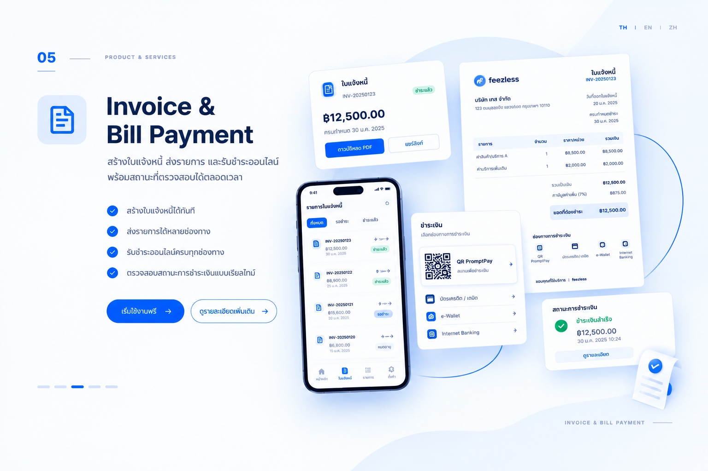

สร้างใบแจ้งหนี้และส่งลิงก์ให้ลูกค้าชำระเงินออนไลน์ผ่าน Feezless จากนั้นติดตามสถานะชำระแล้วหรือค้างชำระได้แบบเรียลไทม์ โดยไม่ต้องจัดทำเอกสารเรียกเก็บเงินแยกด้วยตนเอง

<Frame caption="ภาพประกอบบริการใบแจ้งหนี้และการชำระบิล">
  
</Frame>

## เหมาะสำหรับ

ใช้บริการนี้เมื่อคุณต้องการ:

- เรียกเก็บเงินจากลูกค้าสำหรับบริการหรือคำสั่งซื้อ
- ส่งลิงก์ให้ลูกค้าชำระเงินออนไลน์
- ติดตามบิลที่ชำระแล้วและบิลที่ต้องทวงถาม

## สิ่งที่ต้องเตรียม

ก่อนสร้างใบแจ้งหนี้ ให้เตรียมข้อมูลต่อไปนี้:

- **รายละเอียดการเรียกเก็บเงิน:** รายการสินค้าหรือบริการที่เรียกเก็บจากลูกค้า
- **จำนวนเงินที่ต้องการเรียกเก็บ:** ยอดที่ลูกค้าต้องชำระ
- **ช่องทางการติดต่อ:** วิธีส่งลิงก์ชำระเงินให้ลูกค้า

ติดต่อ [Feezless](https://makeform.ai/e/iY978F0d?__mf_modal_embed=1) เพื่อสอบถามข้อกำหนดการเปิดบัญชีและการตั้งค่า

  

## วิธีการทำงาน

1. สร้างใบแจ้งหนี้พร้อมรายละเอียดการเรียกเก็บเงินและจำนวนเงิน
2. Feezless สร้างลิงก์ชำระเงินออนไลน์สำหรับใบแจ้งหนี้นั้น
3. ส่งลิงก์ให้ลูกค้าผ่านช่องทางการติดต่อที่ต้องการ
4. ลูกค้าเปิดลิงก์และชำระเงินออนไลน์
5. ติดตามสถานะใบแจ้งหนี้แบบเรียลไทม์เพื่อดูว่าชำระแล้วหรือยังค้างชำระ

ดูเส้นทางลูกค้าตั้งแต่ร้านค้าสร้างใบแจ้งหนี้จนถึงติดตามสถานะ โดยเลือกจุดบนเส้นขั้นตอนด้านล่าง ภาพนี้เป็นภาพประกอบ ไม่ใช่หน้าจอหรือสถานะธุรกรรมจริง

<InvoiceFlowVisual />

> **หมายเหตุ:** การส่งลิงก์ชำระเงินเพียงอย่างเดียวไม่ใช่การยืนยันว่าชำระเงินแล้ว ตรวจสอบสถานะการชำระเงินที่ยืนยันแล้วก่อนส่งมอบสินค้าหรือบริการ

## ค่าบริการ

ติดต่อ [Feezless](https://makeform.ai/e/iY978F0d?__mf_modal_embed=1) เพื่อสอบถามอัตราค่าธรรมเนียมธุรกรรมและค่าใช้จ่ายที่เกี่ยวข้องในปัจจุบันก่อนส่งใบแจ้งหนี้ หากมีคำถามเรื่องการตั้งค่าหรือการเชื่อมต่อระบบ ติดต่อ [Feezless](https://makeform.ai/e/iY978F0d?__mf_modal_embed=1)

### ตัวอย่างการคำนวณค่าบริการ

สมมติว่าลูกค้าชำระใบแจ้งหนี้หนึ่งใบเป็นจำนวน 1,000 หน่วยเงิน ยอดนี้ใช้แสดงวิธีคำนวณเท่านั้น ไม่ใช่ค่าบริการออกใบแจ้งหนี้ที่ Feezless กำหนด

เอกสารยังไม่ได้ระบุอัตราค่าธรรมเนียมเป็นตัวเลขสำหรับบริการนี้ **หาก Feezless ยืนยันว่าคิดค่าธรรมเนียมแบบเปอร์เซ็นต์ที่อัตรา r%** จึงใช้สูตรต่อไปนี้ได้ โดย r แทนอัตราที่ได้รับการยืนยัน ไม่ใช่อัตราที่สมมติขึ้น

| รายการ | วิธีคำนวณ | จำนวนหน่วยเงิน |
| --- | --- | --- |
| ยอดชำระตัวอย่าง | 1 รายการ | 1,000 |
| ค่าธรรมเนียมแบบเปอร์เซ็นต์ หากใช้กับบัญชีของคุณ | 1,000 × r ÷ 100 | 10r |
| ยอดคงเหลือหลังหักเฉพาะค่าธรรมเนียมนี้ | 1,000 − 10r | ต้องทราบ r ก่อน |

กรอกอัตราที่ Feezless ยืนยันในเครื่องคำนวณเฉพาะเมื่อใช้การคิดค่าธรรมเนียมแบบเปอร์เซ็นต์ ตารางและเครื่องคำนวณไม่รวมภาษีหรือค่าใช้จ่ายอื่นที่อาจมี และไม่ใช่การยืนยันยอดที่จะได้รับจริง การแสดงทศนิยมสองตำแหน่งมีไว้ประกอบตัวอย่าง ไม่ใช่นโยบายการปัดเศษของ Feezless

<PricingCalculator />

<iframe src="https://zcal.co/emb/feezless?showBackground=1&embed=1&embedType=iframe" title="Book a meeting with Feezless" loading="lazy" style={{ border: "none", width: "100%", maxWidth: "1096px", height: "520px", minHeight: "544px" }} id="zcal-iframe" scrolling="no"></iframe>

## ขั้นตอนถัดไป

- กลับไปยัง [ภาพรวมบริการชำระเงิน](/th/index) เพื่อเปรียบเทียบบริการของ Feezless ทั้งหมด
- ดูบริการ [ลิงก์ชำระเงิน](/th/solutions/checkout/index) หากต้องการรับชำระเงินทันทีโดยไม่ต้องออกใบแจ้งหนี้

export const InvoiceFlowVisual = () => {
  const steps = [
    { label: "เตรียมบิล", title: "ร้านค้าเตรียมรายละเอียดบิล", customer: "รอรับลิงก์ชำระเงินสำหรับใบแจ้งหนี้", merchant: "สร้างใบแจ้งหนี้พร้อมรายละเอียดการเรียกเก็บเงินและจำนวนเงิน", scene: "ร้านค้าจัดทำใบแจ้งหนี้ก่อนส่งลิงก์ให้ลูกค้า" },
    { label: "รับลิงก์", title: "รับลิงก์สำหรับใบแจ้งหนี้", customer: "รับลิงก์จากร้านค้าผ่านช่องทางการติดต่อ", merchant: "Feezless สร้างลิงก์สำหรับใบแจ้งหนี้ แล้วร้านค้าส่งให้ลูกค้า", scene: "ลูกค้ารับลิงก์ชำระเงินสำหรับใบแจ้งหนี้จากร้านค้า" },
    { label: "เปิดลิงก์", title: "เปิดลิงก์เพื่อชำระบิล", customer: "เปิดลิงก์ที่ได้รับเพื่อเข้าสู่หน้าชำระเงิน", merchant: "ใช้ลิงก์ชำระเงินออนไลน์สำหรับใบแจ้งหนี้นั้น", scene: "ลูกค้าเปิดลิงก์ใบแจ้งหนี้บนโทรศัพท์ ยังไม่ได้ยืนยันการชำระเงิน" },
    { label: "ชำระเงิน", title: "ชำระบิลออนไลน์ผ่านลิงก์", customer: "ดำเนินการชำระเงินตามขั้นตอนบนหน้าชำระเงิน", merchant: "ตรวจสอบสถานะการชำระเงินที่ยืนยันแล้วก่อนส่งมอบ", scene: "ลูกค้าชำระเงินผ่านลิงก์ ร้านค้ารอตรวจสอบผล", note: "การส่งลิงก์หรือเปิดหน้าชำระเงินไม่ใช่การยืนยันว่าชำระเงินแล้ว" },
    { label: "ยืนยันผล", title: "ตรวจสอบว่าบิลชำระแล้วหรือยังค้างชำระ", customer: "รับสินค้าหรือบริการเมื่อร้านค้ายืนยันการชำระเงินแล้ว", merchant: "ติดตามสถานะใบแจ้งหนี้แบบเรียลไทม์ว่าชำระแล้วหรือยังค้างชำระ", scene: "ภาพจำลองการตรวจสอบใบแจ้งหนี้หลังยืนยันการชำระเงิน", note: "ส่งมอบสินค้าหรือบริการเมื่อสถานะการชำระเงินได้รับการยืนยันแล้วเท่านั้น" },
  ];
  const [active, setActive] = useState(0);
  const uid = useId().replace(/:/g, "");
  const id = `invoice-story-${uid}`;
  const paint = (name) => `url(#${id}-${name})`;
  const step = steps[active];
  const btn = { display: "inline-flex", alignItems: "center", justifyContent: "center", width: 44, height: 44, padding: 0, borderRadius: 10, border: "1px solid rgba(127,127,127,.3)", background: "transparent", color: "inherit", font: "inherit", cursor: "pointer" };
  return (
    <section className="not-prose invoice-story" aria-label="เส้นทางลูกค้าใบแจ้งหนี้และการชำระบิล" style={{ width: "100%", minWidth: 0, border: "none", padding: 0, display: "grid", gap: 14, color: "inherit", fontFamily: "inherit" }}>
      
      

        <svg viewBox="0 0 640 240" role="img" aria-label={step.scene} style={{ width: "100%", height: "auto", display: "block" }}>
          <defs>
            <linearGradient id={`${id}-blue`} x1="0" y1="0" x2="1" y2="1"><stop offset="0" stopColor="#94b6ff" /><stop offset="1" stopColor="#2454d6" /></linearGradient>
            <linearGradient id={`${id}-white`} x1="0" y1="0" x2="1" y2="1"><stop offset="0" stopColor="#ffffff" /><stop offset="1" stopColor="#dce6fa" /></linearGradient>
            <linearGradient id={`${id}-dark`} x1="0" y1="0" x2="1" y2="1"><stop offset="0" stopColor="#525e78" /><stop offset="1" stopColor="#182139" /></linearGradient>
            <filter id={`${id}-shadow`} x="-50%" y="-100%" width="200%" height="300%"><feGaussianBlur stdDeviation="5" /></filter>
          </defs>
          <ellipse cx="320" cy="210" rx="238" ry="12" fill="#293957" opacity=".12" filter={paint("shadow")} />
          <g transform="translate(110 68)">
            <circle cx="0" cy="0" r="25" fill={paint("white")} />
            <path d="M-38 99V58C-38 20 38 20 38 58V99Z" fill={paint("blue")} />
            <path d="M-24 52Q0 65 24 52" fill="none" stroke="#fff" strokeOpacity=".45" strokeWidth="4" />
            <path d="M28 64L58 48" fill="none" stroke="#78a2fa" strokeWidth="14" strokeLinecap="round" />
          </g>
          <g transform="translate(530 68)">
            <circle cx="0" cy="0" r="25" fill={paint("white")} />
            <path d="M-38 99V58C-38 20 38 20 38 58V99Z" fill={paint("dark")} />
            <path d="M-18 37L0 54L18 37" fill="none" stroke="#a6b9dd" strokeWidth="3" />
            <rect x="-52" y="84" width="104" height="52" rx="10" fill={paint("white")} />
            <rect x="-35" y="94" width="70" height="25" rx="5" fill={paint("blue")} />
          </g>
          <path d={active === 0 ? "M415 128H463" : "M177 128H225M415 128H463"} fill="none" stroke="#7296e4" strokeWidth="3" strokeDasharray="5 7" />
          <path d={active === 0 ? "M425 121L415 128L425 135" : active === 1 || active === 4 ? "M187 121L177 128L187 135M425 121L415 128L425 135" : "M215 121L225 128L215 135M453 121L463 128L453 135"} fill="none" stroke="#4777df" strokeWidth="3" strokeLinecap="round" strokeLinejoin="round" />
          {active === 0 && <g transform="translate(320 115)">
            <rect x="-60" y="-80" width="120" height="166" rx="14" fill={paint("white")} stroke="#c3d2ff" />
            <rect x="-47" y="-64" width="94" height="12" rx="5" fill={paint("blue")} />
            <rect x="-47" y="-40" width="60" height="6" rx="3" fill="#a0b7de" />
            <rect x="-47" y="-28" width="80" height="5" rx="2" fill="#c6d3e8" />
            {[0, 1, 2].map((row) => <g key={row} transform={`translate(0 ${row * 22})`}><rect x="-47" y="-10" width="15" height="15" rx="4" fill="#d6e3fb" /><rect x="-23" y="-7" width="40" height="5" rx="2" fill="#a0b7de" /><rect x="29" y="-7" width="18" height="5" rx="2" fill="#c6d3e8" /></g>)}
            <path d="M-47 60H47" stroke="#c6d3e8" /><rect x="11" y="68" width="36" height="7" rx="3" fill={paint("blue")} />
          </g>}
          {active === 1 && <g transform="translate(320 118)">
            <path d="M-48-62H48Q62-62 62-48V34Q62 48 48 48H-22L-48 66V48Q-62 48-62 34V-48Q-62-62-48-62Z" fill={paint("white")} stroke="#c3d2ff" />
            <rect x="-43" y="-44" width="70" height="7" rx="3" fill="#a0b7de" /><rect x="-43" y="-28" width="86" height="5" rx="2" fill="#c6d3e8" />
            <g transform="translate(0 8) rotate(-32)" fill="none" stroke="#4777df" strokeWidth="6"><rect x="-34" y="-11" width="42" height="22" rx="11" /><rect x="-8" y="-11" width="42" height="22" rx="11" /><path d="M-9 0H9" /></g>
          </g>}
          {active === 2 && <g transform="translate(320 118)">
            <rect x="-39" y="-76" width="78" height="152" rx="16" fill={paint("dark")} />
            <rect x="-32" y="-68" width="64" height="136" rx="11" fill={paint("white")} />
            <rect x="-23" y="-52" width="46" height="10" rx="5" fill={paint("blue")} />
            {[0, 1, 2].map((row) => <g key={row}><rect x="-23" y={-26 + row * 19} width="26" height="5" rx="2" fill="#a0b7de" /><rect x="11" y={-26 + row * 19} width="12" height="5" rx="2" fill="#c6d3e8" /></g>)}
            <rect x="-23" y="35" width="46" height="14" rx="7" fill={paint("blue")} />
            <circle cx="44" cy="-51" r="20" fill={paint("blue")} /><path d="M37-44L51-58M39-58H51V-46" fill="none" stroke="#fff" strokeWidth="3" strokeLinecap="round" strokeLinejoin="round" />
          </g>}
          {active === 3 && <g transform="translate(320 118)">
            <rect x="-35" y="-75" width="70" height="150" rx="16" fill={paint("dark")} />
            <rect x="-30" y="-68" width="60" height="136" rx="11" fill={paint("white")} />
            <rect x="-22" y="-56" width="44" height="10" rx="5" fill={paint("blue")} />
            <rect x="-22" y="-38" width="44" height="6" rx="3" fill="#a0b7de" />
            {[0,1,2].map((row) => (
              <rect key={row} x="-22" y={-20 + row * 22} width="44" height="16" rx="6" fill={row === 1 ? "#dbe4fb" : "#edf1f8"} stroke={row === 1 ? "#4777df" : "#d5ddeb"} />
            ))}
            <circle cx="0" cy="-2" r="5" fill="#4777df" />
            <rect x="-22" y="52" width="44" height="10" rx="5" fill="#4777df" opacity=".85" />
          </g>}
          {active === 4 && <g transform="translate(320 118)">
            <rect x="-55" y="-50" width="110" height="100" rx="14" fill={paint("white")} stroke="#c3d2ff" />
            <rect x="-45" y="-40" width="90" height="10" rx="5" fill={paint("blue")} />
            <rect x="-45" y="-22" width="70" height="6" rx="3" fill="#a0b7de" />
            <rect x="-45" y="-12" width="50" height="6" rx="3" fill="#c6d3e8" />
            <rect x="-45" y="4" width="40" height="10" rx="5" fill="#2f6bff" opacity=".85" />
            <rect x="-1" y="4" width="46" height="10" rx="5" fill="#c6d3e8" />
            <rect x="-45" y="22" width="90" height="6" rx="3" fill="#dbe4fb" />
            <rect x="-45" y="34" width="60" height="6" rx="3" fill="#dbe4fb" />
            <circle cx="45" cy="-48" r="20" fill={paint("blue")} />
            <path d="M35-48 L42-41 L56-55" fill="none" stroke="#fff" strokeWidth="4" strokeLinecap="round" strokeLinejoin="round" />
          </g>}
        </svg>
        
ลูกค้าร้านค้า

      

      

        

        

        {steps.map((item, i) => <button key={item.label} type="button" onClick={() => setActive(i)} aria-pressed={active === i} aria-controls={`${id}-detail`} aria-label={`ขั้นตอนที่ ${i + 1}: ${item.label}`} style={{ position: "relative", zIndex: 1, display: "flex", flexDirection: "column", alignItems: "center", gap: 8, width: "100%", minWidth: 0, minHeight: 70, padding: "0 4px 6px", border: "none", borderRadius: 8, background: "transparent", color: "inherit", font: "inherit", fontSize: 13, lineHeight: 1.5, cursor: "pointer" }}>
          {i + 1}
          {item.label}
        </button>)}
      

      

        
{step.title}

        

          

มุมลูกค้า

{step.customer}

          

ร้านค้าและระบบ

{step.merchant}

        

        {step.note && 
<strong>ก่อนส่งมอบ: </strong>{step.note}
}
      

      

        <button type="button" style={btn} disabled={active === 0} onClick={() => setActive((value) => Math.max(0, value - 1))} aria-label="ย้อนกลับ" title="ย้อนกลับ"><Icon icon="chevron-left" size={16} /></button>
        {active + 1} / {steps.length}
        <button type="button" style={btn} disabled={active === steps.length - 1} onClick={() => setActive((value) => Math.min(steps.length - 1, value + 1))} aria-label="ถัดไป" title="ถัดไป"><Icon icon="chevron-right" size={16} /></button>
      

    </section>
  );
};

export const PricingCalculator = () => {
  const [amount, setAmount] = useState("1000");
  const [rate, setRate] = useState("");
  const value = Number(amount);
  const percent = Number(rate);
  const fee = value * (percent / 100);
  const remainder = value - fee;
  const valid = amount.trim() !== "" && rate.trim() !== "" && Number.isFinite(value) && value >= 0 && Number.isFinite(percent) && percent >= 0 && Number.isFinite(fee) && Number.isFinite(remainder);
  const format = (number) => number.toLocaleString("th-TH", { minimumFractionDigits: 2, maximumFractionDigits: 2 });
  const inputStyle = { width: "100%", minWidth: 0, boxSizing: "border-box", border: "1px solid rgba(127,127,127,.35)", borderRadius: 8, padding: "8px 12px", background: "transparent", color: "inherit", font: "inherit" };
  return (
    

      <strong>คำนวณเมื่อทราบอัตราแบบเปอร์เซ็นต์แล้ว</strong>
      <label style={{ display: "grid", gap: 6 }}>
        ยอดชำระตัวอย่าง (หน่วยเงิน)
        <input type="number" min="0" step="any" value={amount} onChange={(event) => setAmount(event.target.value)} style={inputStyle} />
      </label>
      <label style={{ display: "grid", gap: 6 }}>
        อัตราแบบเปอร์เซ็นต์ที่ Feezless ยืนยัน (%)
        <input type="number" min="0" step="any" value={rate} onChange={(event) => setRate(event.target.value)} style={inputStyle} />
      </label>
      

        {valid ? <>
ค่าธรรมเนียม: <strong>{format(fee)} หน่วยเงิน</strong>

ยอดคงเหลือหลังหักเฉพาะค่าธรรมเนียมนี้: <strong>{format(remainder)} หน่วยเงิน</strong>
</> : 
กรอกยอดชำระและอัตราที่ Feezless ยืนยันเป็นตัวเลขที่ไม่ติดลบ เฉพาะเมื่อใช้การคิดค่าธรรมเนียมแบบเปอร์เซ็นต์ ช่องอัตราที่ว่างไม่ได้หมายถึงค่าธรรมเนียม 0%
}
      

      <small>ไม่รวมภาษีหรือค่าใช้จ่ายอื่นที่อาจมี ไม่ใช่ยอดรับเงินจริง แสดงทศนิยมสองตำแหน่งเพื่อประกอบตัวอย่างเท่านั้น</small>
    

  );
};
