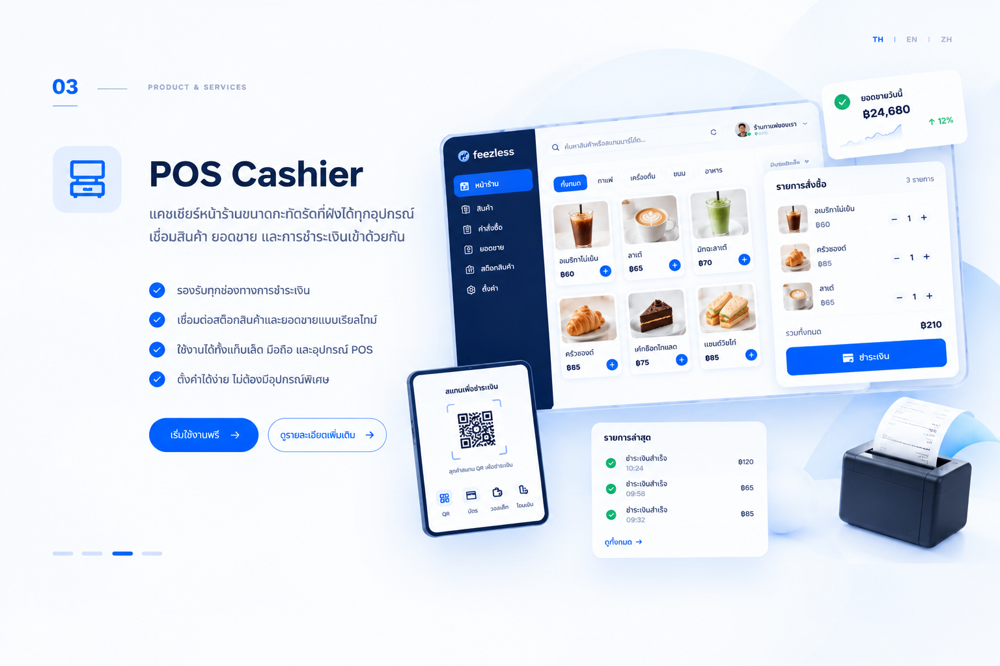

ระบบสมาชิกของ Feezless เชื่อมการชำระเงินครั้งแรกของลูกค้าเข้ากับโปรแกรมสมาชิกของคุณ ออกบัตรสมาชิกดิจิทัลและส่งผ่านช่องทางที่ลูกค้าเลือก จากนั้นให้ลูกค้าตั้งรหัส PIN และให้ความยินยอมตาม PDPA ด้วยตนเองผ่านลิงก์

<Frame caption="ภาพประกอบบริการระบบสมาชิกและสิทธิประโยชน์">
  
</Frame>

## เมื่อใดควรใช้ระบบสมาชิก

เหมาะสำหรับธุรกิจที่ต้องการรวมการสมัครสมาชิกและส่งบัตรดิจิทัลไว้ในขั้นตอนชำระเงิน โดยให้ลูกค้าตั้งรหัส PIN และให้ความยินยอมด้วยตนเอง แทนการให้พนักงานดำเนินการ

## สิ่งที่ต้องเตรียม

เตรียมข้อมูลต่อไปนี้ให้พร้อมเมื่อปรึกษาเรื่องการตั้งค่ากับ Feezless:

- โปรแกรมสมาชิกที่ต้องการให้ลูกค้าเข้าร่วม
- ข้อมูลที่ต้องการแสดงบนบัตรสมาชิกดิจิทัล
- ช่องทางที่ต้องการให้ลูกค้ารับบัตรและลิงก์ตั้งค่า

ข้อมูลเหล่านี้ช่วยให้คุณเตรียมขั้นตอนการสมัครสมาชิก ติดต่อ [Feezless](https://zcal.co/i/gFYmG_pU) เพื่อสอบถามข้อกำหนดการเปิดบัญชีและช่องทางส่งบัตรที่มีให้ใช้งาน

## วิธีการทำงาน

1. การชำระเงินครั้งแรกของลูกค้าเริ่มต้นขั้นตอนการสมัครสมาชิก
2. ระบบออกบัตรสมาชิกดิจิทัลเป็นส่วนหนึ่งของขั้นตอนดังกล่าว
3. ระบบส่งบัตรผ่านช่องทางที่ลูกค้าเลือก
4. ลูกค้าเปิดลิงก์เพื่อตั้งรหัส PIN และให้ความยินยอมตาม PDPA ด้วยตนเอง

ตัวอย่างสมมติ: ลูกค้าชำระค่าสินค้าครั้งแรกเพื่อเริ่มขั้นตอนสมัครสมาชิก รับบัตรดิจิทัล แล้วตั้ง PIN และให้ความยินยอมตาม PDPA ด้วยตนเอง

ไอคอนคนแทนลูกค้า ไอคอนร้านแทนร้านค้า และไอคอน Feezless แทนระบบ ภาพนี้เป็นภาพประกอบ ไม่ใช่หน้าจอหรือสถานะธุรกรรมจริง

<MembershipFlowVisual />

แยกการยืนยันการชำระเงินออกจากการตั้งรหัส PIN และการให้ความยินยอม การสร้างหรือเปิดลิงก์ชำระเงินไม่ได้ยืนยันว่าลูกค้าชำระเงินแล้ว

## ค่าบริการ

ติดต่อ [Feezless](https://zcal.co/i/gFYmG_pU) เพื่อสอบถามอัตราค่าธรรมเนียมธุรกรรมของระบบสมาชิกและค่าใช้จ่ายที่เกี่ยวข้องในปัจจุบัน พร้อมระบุขั้นตอนการสมัครสมาชิกที่ต้องการ เพื่อให้ทีมงานแนะนำการตั้งค่าและค่าบริการ

### ตัวอย่างการคำนวณค่าบริการ

สมมติว่าลูกค้าชำระเงินครั้งแรกที่เชื่อมกับการสมัครสมาชิกเป็นจำนวน 1,000 หน่วยเงิน ยอดนี้เป็นตัวอย่างการชำระเงิน ไม่ใช่ค่าสมัครสมาชิก ค่าสมาชิกรายเดือน หรือค่าบริการที่ Feezless กำหนด

เอกสารยังไม่ได้ระบุอัตราค่าธรรมเนียมเป็นตัวเลขสำหรับบริการนี้ **หาก Feezless ยืนยันว่าคิดค่าธรรมเนียมแบบเปอร์เซ็นต์ที่อัตรา r%** จึงใช้สูตรต่อไปนี้ได้ โดย r แทนอัตราที่ได้รับการยืนยัน ไม่ใช่อัตราที่สมมติขึ้น

| รายการ | วิธีคำนวณ | จำนวนหน่วยเงิน |
| --- | --- | --- |
| ยอดชำระตัวอย่าง | 1 รายการ | 1,000 |
| ค่าธรรมเนียมแบบเปอร์เซ็นต์ หากใช้กับบัญชีของคุณ | 1,000 × r ÷ 100 | 10r |
| ยอดคงเหลือหลังหักเฉพาะค่าธรรมเนียมนี้ | 1,000 − 10r | ต้องทราบ r ก่อน |

กรอกอัตราที่ Feezless ยืนยันในเครื่องคำนวณเฉพาะเมื่อใช้การคิดค่าธรรมเนียมแบบเปอร์เซ็นต์ ตารางและเครื่องคำนวณไม่รวมภาษีหรือค่าใช้จ่ายอื่นที่อาจมี และไม่ใช่การยืนยันยอดที่จะได้รับจริง การแสดงทศนิยมสองตำแหน่งมีไว้ประกอบตัวอย่าง ไม่ใช่นโยบายการปัดเศษของ Feezless

<PricingCalculator />

<iframe src="https://zcal.co/i/gFYmG_pU?embed=1&embedType=iframe" title="Book a meeting with Feezless" loading="lazy" style={{ border: "none", width: "100%", maxWidth: "1096px", minWidth: "min(320px, 100%)", height: "723px", minHeight: "544px" }} id="zcal-invite" scrolling="no" />

## ขั้นตอนถัดไป

- กลับไปยัง [ภาพรวมบริการชำระเงิน](/th/index) เพื่อเปรียบเทียบบริการ

export const MembershipFlowVisual = () => {
  const povLabels = { customer: "ลูกค้า", merchant: "ร้านค้า", system: "ระบบ Feezless" };
  const steps = [
    { label: "ชำระครั้งแรก", title: "ชำระเงินครั้งแรก", pov: "customer", story: "ลูกค้าชำระค่าสินค้าครั้งแรกที่ร้านเพื่อเริ่มขั้นตอนสมัครสมาชิก" },
    { label: "ออกบัตร", title: "ออกบัตรสมาชิกดิจิทัล", pov: "system", story: "Feezless ออกบัตรสมาชิกดิจิทัลให้ลูกค้าในขั้นตอนสมัครสมาชิก" },
    { label: "รับบัตร", title: "รับบัตรผ่านช่องทางที่เลือก", pov: "customer", story: "ลูกค้ารับบัตรสมาชิกของร้านผ่านช่องทางที่เลือกไว้" },
    { label: "ตั้งค่าด้วยตนเอง", title: "ตั้ง PIN และให้ความยินยอม", pov: "customer", story: "ลูกค้าเปิดลิงก์เพื่อตั้ง PIN และให้ความยินยอมตาม PDPA ด้วยตนเอง" },
  ];
  const [active, setActive] = useState(0);
  const uid = useId().replace(/:/g, "");
  const id = `membership-story-${uid}`;
  const panels = [
    { kind: "payment", screen: "Payment", actor: "ลูกค้า" },
    { kind: "system", screen: "บัตรสมาชิกดิจิทัล", actor: "ระบบ" },
    { kind: "card", screen: "Membership", actor: "ลูกค้า" },
    { kind: "consent", screen: "PIN / PDPA", actor: "ลูกค้า" },
  ];
  const currentConnector = Math.max(0, active - 1);
  const actorIcon = (pov, size = 24) => (
    
      {pov === "system" ?  : pov === "merchant" ? <Icon icon="building-store" size={size} color="var(--fv-text)" /> : <Icon icon="user" size={size} color="var(--fv-text)" />}
    
  );
  return (
    <section className="not-prose membership-story" aria-label="เส้นทางลูกค้าสมัครสมาชิก" style={{ width: "100%", minWidth: 0, border: "none", padding: 0, display: "grid", gap: 14, color: "var(--fv-text)", background: "transparent", borderRadius: 16, fontFamily: "inherit" }}>
      
      

        {steps.slice(0, -1).map((_, i) => 
)}
        {steps.map((item, i) => <button key={item.label} className="flow-step-button" data-passed={i < active ? "true" : "false"} type="button" onClick={() => setActive(i)} aria-pressed={active === i} aria-controls={`${id}-diagram`} aria-label={`ขั้นตอนที่ ${i + 1}: ${item.label}`} style={{ position: "relative", zIndex: 1, display: "flex", flexDirection: "column", alignItems: "center", gap: 8, width: "100%", minWidth: 0, minHeight: 70, padding: "0 4px 6px", border: "none", borderRadius: 8, background: "transparent", color: "inherit", font: "inherit", fontSize: 13, lineHeight: 1.5, cursor: "pointer" }}>
          {i + 1}
          {item.label}
        </button>)}
      

      

        
        

          
          Feezless Platform
        

        <ol id={`${id}-diagram`} className="flow-diagram" aria-label="ภาพรวมลำดับขั้นตอน">
          {steps.map((item, i) => {
            const panel = panels[i];
            const selected = active === i;
            const reverse = Math.floor(i / 2) % 2 === 1;
            const downward = i % 2 === 1;
            const ink = selected ? "var(--fv-accent)" : "var(--fv-muted)";
            return <li key={item.label} className="flow-stage" aria-current={selected ? "step" : undefined} style={{ gridColumn: reverse ? 2 - i % 2 : i % 2 + 1, gridRow: Math.floor(i / 2) + 1 }}>
              

                

                  {i + 1}
                  

                    {actorIcon(item.pov)}
                    

                      
{povLabels[item.pov]}

                      
{item.title}

                      
{item.story}

                    

                  

                

                <svg viewBox="0 0 240 150" aria-hidden="true" style={{ width: "100%", maxWidth: 280, height: "auto", display: "block", margin: "0 auto" }}>
                  {panel.kind === "system" ? <g>
                    {[0, 1, 2, 3].map((row) => <g key={row} transform={`translate(20 ${16 + row * 30})`}><rect width="200" height="28" fill="var(--fv-surface)" stroke="var(--fv-line)" /><circle cx="14" cy="14" r="4" fill={ink} /><path d="M178 7V21M184 7V21M190 7V21" stroke="var(--fv-muted)" strokeWidth="2" /></g>)}
                    <rect x="55" y="57" width="130" height="37" fill="var(--fv-surface)" stroke="var(--fv-line)" /><text x="120" y="80" textAnchor="middle" fontSize="14" fill="var(--fv-text)" fontFamily="inherit">{panel.screen}</text>
                  </g> : <g>
                    <rect x="5" y="5" width="230" height="140" rx="4" fill="var(--fv-bg)" stroke="var(--fv-line)" />
                    <path d="M6 23H234" stroke="var(--fv-line)" /><rect x="6" y="6" width="228" height="16" rx="3" fill="var(--fv-surface)" />
                    <circle cx="14" cy="14" r="2.5" fill="#ea4335" /><circle cx="23" cy="14" r="2.5" fill="#fbbc04" /><circle cx="32" cy="14" r="2.5" fill="#34a853" />
                    <text x="18" y="42" fill="var(--fv-text)" fontSize="12" fontFamily="inherit">{panel.screen}</text><path d="M6 50H234" stroke="var(--fv-line)" />
                    {panel.kind === "payment" && <g>
                      {[0, 1, 2].map((row) => <g key={row} transform={`translate(18 ${61 + row * 20})`}><rect width="14" height="10" rx="2" fill="var(--fv-surface)" /><rect x="25" y="2" width={142 - row * 22} height="5" fill="var(--fv-line)" /><path d="M0 16H202" stroke="var(--fv-surface)" /></g>)}
                      <circle cx="33" cy="126" r="9" fill="none" stroke="var(--fv-muted)" strokeWidth="1.5" /><path d="M33 120V126L37 129" fill="none" stroke="var(--fv-muted)" strokeWidth="1.5" /><rect x="164" y="119" width="56" height="15" rx="2" fill="var(--fv-accent)" />
                    </g>}
                    {panel.kind === "card" && <g>
                      <rect x="28" y="58" width="184" height="72" rx="6" fill="var(--fv-bg)" stroke="var(--fv-line)" />
                      <rect x="40" y="68" width="48" height="48" rx="24" fill="var(--fv-surface)" />
                      <rect x="100" y="72" width="96" height="6" rx="3" fill="var(--fv-muted)" />
                      <rect x="100" y="86" width="72" height="4" rx="2" fill="var(--fv-line)" />
                      <rect x="100" y="96" width="80" height="4" rx="2" fill="var(--fv-line)" />
                      <rect x="100" y="106" width="56" height="4" rx="2" fill="var(--fv-line)" />
                    </g>}
                    {panel.kind === "consent" && <g>
                      <rect x="24" y="61" width="192" height="28" rx="3" fill="var(--fv-bg)" stroke="var(--fv-line)" strokeWidth="1.5" />
                      <path d="M35 75H153" stroke="var(--fv-line)" strokeWidth="4" />
                      <rect x="24" y="106" width="14" height="14" rx="2" fill="var(--fv-bg)" stroke="var(--fv-muted)" strokeWidth="1.5" />
                      <rect x="48" y="108" width="156" height="4" fill="var(--fv-muted)" /><rect x="48" y="119" width="126" height="4" fill="var(--fv-line)" />
                    </g>}
                  </g>}
                </svg>
              

              {i < steps.length - 1 && 

                <svg viewBox="0 0 64 64" style={{ width: "100%", height: "100%", display: "block" }}>
                  <g className="flow-connector" data-active={i === currentConnector ? "true" : "false"}>
                    <path d="M6 32H21M43 32H57" fill="none" stroke={i === currentConnector ? "var(--fv-accent)" : "var(--fv-line)"} strokeWidth="1.8" strokeDasharray={i === currentConnector ? undefined : "1 5"} strokeLinecap="round" />
                    <path d="M50 26L57 32L50 38" fill="none" stroke={i === currentConnector ? "var(--fv-accent)" : "var(--fv-line)"} strokeWidth="1.8" strokeLinecap="round" strokeLinejoin="round" />
                  </g>
                  <circle cx="32" cy="32" r="11" fill="var(--fv-bg)" stroke="var(--fv-text)" strokeWidth="1.2" />
                  <g className="flow-arrow-number" style={{ transformOrigin: "32px 32px", transform: downward ? "rotate(-90deg)" : reverse ? "rotate(-180deg)" : "none" }}><text x="32" y="36.5" textAnchor="middle" fontFamily="inherit" fontSize="13" fill="var(--fv-text)">{i + 2}</text></g>
                </svg>
              
}
            </li>;
          })}
        </ol>
        
ภาพลำดับขั้นตอน ไม่ใช่โครงสร้างระบบ หน้าจอ หรือสถานะธุรกรรมจริง

      

    </section>
  );
};

export const PricingCalculator = () => {
  const [amount, setAmount] = useState("1000");
  const [rate, setRate] = useState("");
  const value = Number(amount);
  const percent = Number(rate);
  const fee = value * (percent / 100);
  const remainder = value - fee;
  const valid = amount.trim() !== "" && rate.trim() !== "" && Number.isFinite(value) && value >= 0 && Number.isFinite(percent) && percent >= 0 && Number.isFinite(fee) && Number.isFinite(remainder);
  const format = (number) => number.toLocaleString("th-TH", { minimumFractionDigits: 2, maximumFractionDigits: 2 });
  const inputStyle = { width: "100%", minWidth: 0, boxSizing: "border-box", border: "1.5px solid var(--fv-line)", borderRadius: 8, padding: "8px 12px", background: "var(--fv-bg)", color: "var(--fv-text)", font: "inherit" };
  return (
    

      
      <strong style={{ color: "var(--fv-text)" }}>คำนวณเมื่อทราบอัตราแบบเปอร์เซ็นต์แล้ว</strong>
      <label style={{ display: "grid", gap: 6, color: "var(--fv-text)" }}>
        ยอดชำระตัวอย่าง (หน่วยเงิน)
        <input type="number" min="0" step="any" value={amount} onChange={(event) => setAmount(event.target.value)} style={{ ...inputStyle, borderColor: "var(--fv-line)" }} />
      </label>
      <label style={{ display: "grid", gap: 6, color: "var(--fv-text)" }}>
        อัตราแบบเปอร์เซ็นต์ที่ Feezless ยืนยัน (%)
        <input type="number" min="0" step="any" value={rate} onChange={(event) => setRate(event.target.value)} style={{ ...inputStyle, borderColor: "var(--fv-line)" }} />
      </label>
      

        {valid ? <>
ค่าธรรมเนียม: <strong>{format(fee)} หน่วยเงิน</strong>

ยอดคงเหลือหลังหักเฉพาะค่าธรรมเนียมนี้: <strong>{format(remainder)} หน่วยเงิน</strong>
</> : 
กรอกยอดชำระและอัตราที่ Feezless ยืนยันเป็นตัวเลขที่ไม่ติดลบ เฉพาะเมื่อใช้การคิดค่าธรรมเนียมแบบเปอร์เซ็นต์ ช่องอัตราที่ว่างไม่ได้หมายถึงค่าธรรมเนียม 0%
}
      

      <small>ไม่รวมภาษีหรือค่าใช้จ่ายอื่นที่อาจมี ไม่ใช่ยอดรับเงินจริง แสดงทศนิยมสองตำแหน่งเพื่อประกอบตัวอย่างเท่านั้น</small>
    

  );
};
